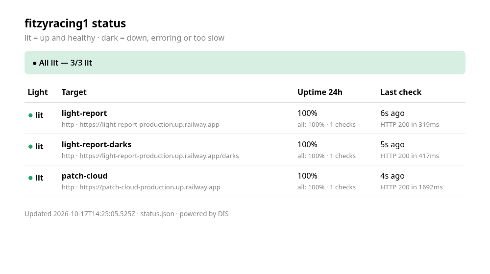
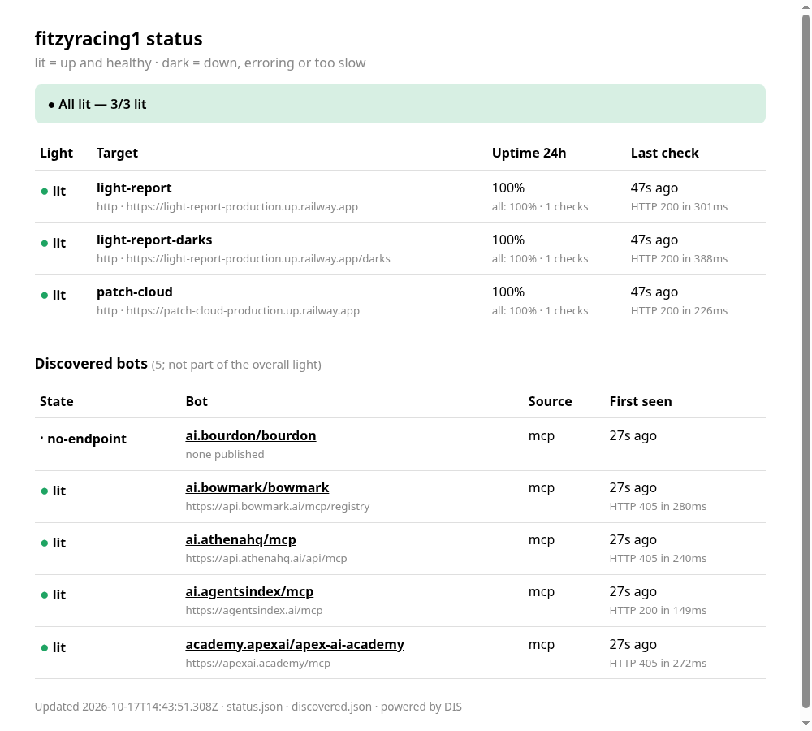

# ● DIS

[](https://github.com/fitzyracing1/DIS/actions/workflows/ci.yml)
[](https://github.com/fitzyracing1/DIS/actions/workflows/status.yml)

**A self-hostable status bot: it watches your sites and marks each one lit or dark.**
Point DIS at your sites and it checks them on a schedule. Each target is **lit** (up and healthy) or **dark**
(down, erroring, or too slow). DIS sends a webhook when a light changes, serves a small status page plus JSON,
and can also run as a GitHub Actions cron job, so you don't need a server.

Node 18+, **zero dependencies**, MIT. Part of the lit/dark family with
[light-report](https://github.com/fitzyracing1/light-report): DIS can mirror every target to a light-report server.



## Quick start

```bash
git clone https://github.com/fitzyracing1/DIS.git && cd DIS
node bin/dis.mjs once      # check everything once: exit 0 = all lit, 1 = something dark
node bin/dis.mjs serve     # run forever; open http://localhost:8080
npm test                   # node:test, no install needed
```

Then edit `status.config.json` to watch your own sites. If you `npm link` it, the command is just `dis`.

## Config: `status.config.json`

```json
{
  "title": "My status",
  "defaults": { "intervalSeconds": 60, "timeoutMs": 10000, "maxLatencyMs": 5000, "failThreshold": 2, "recoverThreshold": 1 },
  "targets": [
    { "name": "site",     "type": "http", "url": "https://example.com", "expectStatus": 200, "keyword": "Example Domain", "maxLatencyMs": 3000 },
    { "name": "postgres", "type": "tcp",  "host": "db.example.com", "port": 5432, "intervalSeconds": 120 },
    { "name": "dns",      "type": "dns",  "host": "example.com", "recordType": "A" }
  ],
  "alerts": [
    { "type": "discord", "url": "${DISCORD_WEBHOOK_URL}" },
    { "type": "slack",   "url": "${SLACK_WEBHOOK_URL}", "on": ["dark"] },
    { "type": "json",    "url": "${ALERT_WEBHOOK_URL}" }
  ],
  "lightReport": { "url": "${LIGHT_REPORT_URL}", "prefix": "net-", "heartbeatMinutes": 15 }
}
```

- `${VAR}` in any string is filled in from the environment, so secrets stay in env vars. If an alert or
  `lightReport` URL comes out empty, that adapter is just switched off. The shipped config works with no env set.
- Each target can override any value in `defaults`.
- To set the whole config from one env var, put the JSON in `DIS_CONFIG_JSON`. Handy on Railway.
  Use `DIS_CONFIG` to point at a different file.
- See [`examples/all-check-types.config.json`](examples/all-check-types.config.json) for an example of every option.

### Check types

| type | fields | lit when |
|---|---|---|
| `http` | `url`, `method` (GET), `expectStatus` (default `"200-399"`; also `200`, `"2xx"`, `[200, 204]`), `keyword`, `headers`, `followRedirects` (true) | status matches, the body contains `keyword` if one is set, and the full response arrives within `maxLatencyMs` |
| `tcp` | `host`, `port` | the port accepts a connection within `maxLatencyMs` |
| `dns` | `host`, `recordType` (`A` AAAA CNAME MX TXT NS), `expect` (substring), `server` (e.g. `1.1.1.1`) | it resolves to at least one record, matching `expect` if one is set |

Common fields: `name` (letters, digits, `. _ -`), `intervalSeconds` (60), `timeoutMs` (10000), `maxLatencyMs` (5000).

### Lit, dark and debounce

- **lit → dark** only after `failThreshold` failures in a row (default **2**), so one blip doesn't page you.
- **dark → lit** after `recoverThreshold` successes in a row (default 1).
- Alerts fire **only on a change**. The first lit after startup is silent; a first dark is not.
- Uptime is shown for all time and for the last 24 h (the last 1440 checks per target are kept).

## Alerts (webhooks)

| type | body |
|---|---|
| `discord` | `{username, content, embeds:[…]}`: paste a Discord channel webhook URL |
| `slack` | `{text}`: a Slack incoming webhook URL |
| `json` | `{event:"state_change", name, type, target, from, to, light, bit, detail, at, text}`: anything else |

Optional per-alert fields: `"on": ["dark"]` to hear only about outages, and `"headers": {…}` (e.g. an auth header for `json`).
A failing webhook is logged and never stops the checks.

## Optional: report to light-report

If `lightReport.url` is set, each target is also posted as a light `<prefix><name>` (e.g. `net-patch-cloud`)
using light-report's API: `POST /lights/:name` with `{"state":"lit"|"dark","source":"dis","detail":…}`.
It posts when a light changes, plus a heartbeat every `heartbeatMinutes` so the light doesn't go stale
(light-report marks lights dark after its TTL, 24 h by default). Cron mode posts on every run.

Tokens: the first report of a new name gets back a write token, and DIS saves it in the state file.
Token lookup order: `lightReport.tokens["<target>"]` → env `LIGHT_TOKEN_<LIGHT_NAME>` (same convention as `light-run`,
e.g. `LIGHT_TOKEN_NET_PATCH_CLOUD`) → env `LIGHT_TOKEN` → `lightReport.token` → the saved token.
On an ephemeral host (no volume, or GitHub Actions without the cache), pin the tokens as env vars or secrets.
Tokens are never printed when `CI` / `GITHUB_ACTIONS` is set.
Then read the lights back with `curl $LIGHT_REPORT_URL/lights/net-patch-cloud/LIGHT` or use a badge.

## Web page and JSON

| | |
|---|---|
| `GET /` | status page (refreshes every 30 s) |
| `GET /status.json` (alias `/api/status`) | `{title, light, counts, generatedAt, targets:[{name, type, target, light, bit, since, lastCheck, uptime:{all,"24h"}, checks, lastChange}]}` |
| `GET /lights/:name` · `/lights/:name/LIGHT` | one target as JSON · `lit` / `dark` / `pending` |
| `GET /LIGHT` | `lit` only when every target is lit |
| `GET /healthz` | `ok`: DIS itself is up (use this for platform health checks) |
| `GET` / `POST /check` | on-demand check of any public URL: see [below](#on-demand-check-api-for-other-bots) (off by default) |
| `GET /discovered.json` | discovered bots, when [discovery](#discovery-watch-newly-published-bots-optional) is on |
| `POST /register` · `/register/verify` · `GET /register/:id` | self-registration (off by default) |

## On-demand check API (for other bots)

Other bots can ask DIS whether a URL is lit or dark right now:

```bash
curl -s -X POST https://your-dis.example/check -H "Authorization: Bearer $DIS_API_KEY" \
  -H 'content-type: application/json' \
  -d '{"url":"https://example.com","type":"http","expect":200,"maxMs":3000}'
curl -s -H "X-API-Key: $DIS_API_KEY" "https://your-dis.example/check?url=https://example.com&keyword=Example"
```

```json
{ "state": "lit", "bit": 0, "type": "http", "target": "https://example.com/", "status": 200, "ms": 231,
  "detail": "HTTP 200 in 231ms", "checkedAt": "2026-10-17T14:35:50.539Z", "redirects": 0, "bytes": 1256, "truncated": false }
```

| field | for | meaning |
|---|---|---|
| `url` | all | `https://…` for http; `host:port` or `tcp://host:port` for tcp; a hostname for dns (`host` also works) |
| `type` | all | `http` (default), `tcp`, `dns` |
| `expect` | http | status: `200`, `"2xx"`, `"200-299"`, `[200, 204]` or `"200,204"` (default `"200-399"`) |
| `expect` | dns | substring that one of the records must contain |
| `maxMs` | all | slower than this is dark (default 5000, capped at 10000) |
| `keyword` | http | the body must contain it (only the first 256 KB is read) |
| `method` | http | `GET` (default) or `HEAD` |
| `port`, `recordType` | tcp, dns | port 1-65535 · `A` AAAA CNAME MX TXT NS |

A finished check always returns HTTP 200, with `state` set to lit or dark. Other responses: `400` bad input,
`401` missing or wrong key, `404` the API is off, `429` rate limited (see `Retry-After`), `503` too many checks at once.

**It is off by default.** To turn it on:

| env | effect |
|---|---|
| `DIS_API_KEY` | on; callers must send `Authorization: Bearer <key>` or `X-API-Key: <key>` (always required once a key is set) |
| `DIS_PUBLIC_CHECK=1` | on with no key: anyone can call it (rate limits still apply) |
| `DIS_CHECK_RATE` | checks per minute per client IP (default 30) |
| `DIS_CHECK_CONCURRENCY` | checks running at once (default 10) |
| `DIS_TRUST_PROXY=1` | behind one reverse proxy (Railway, Fly, nginx): rate-limit on the last `X-Forwarded-For` hop |
| `DIS_CHECK_ALLOW_CIDRS` | operator escape hatch, e.g. `10.20.0.0/16`, to allow checking your own private range |

**SSRF protection.** The caller picks the URL, so every API check goes through `lib/net-guard.mjs`:
- Only `http:`/`https:` URLs are accepted, and URLs with `user:pass@` are rejected.
- The hostname is resolved by DIS, and the connection is made only to the addresses it checked, so DNS rebinding can't swap them.
  If **any** address is private, loopback, link-local, a cloud metadata address (`169.254.169.254`, `fd00:ec2::254`),
  CGNAT, multicast or reserved, the check is refused. IPv4-mapped, NAT64 and 6to4 forms are decoded and checked too.
- Redirects (at most 3) are re-checked at every hop.
- Each check has one overall timeout (`maxMs` + 2 s, capped at 10 s), the response body is capped at 256 KB,
  and a 4 KB limit applies to the request body.
- DNS checks never reveal private answers.

Targets in `status.config.json` are chosen by you, not by callers, so they are not filtered and you can watch internal services.

### `dis check` (CLI)

```bash
dis check https://example.com                    # ● lit  https://example.com/  HTTP 200 in 60ms   (exit 0)
dis check example.com:5432 --type tcp --max-ms 2000
dis check example.com --type dns --record MX --json
dis check http://10.0.0.5/health --allow-private # skip the guard for your own network (local use only)
```

Exit codes: `0` lit, `1` dark (including blocked), `2` bad input. The CLI uses the same SSRF guard by default, so it is
safe for a bot to shell out to with an untrusted URL.

## Discovery: watch newly published bots (optional)

DIS can find newly published bots and services and watch the **one endpoint each bot published itself**.
It only reads official APIs and feeds, and only sends polite GET requests. Discovery is **off by default**.

```json
"discovery": {
  "enabled": true,
  "everyMinutes": 60, "lookbackHours": 24, "perRunLimit": 20,
  "maxTargets": 50, "perHostMax": 3, "maxRecords": 500, "intervalSeconds": 300,
  "keywords": ["bot", "discord-bot", "telegram-bot", "slack-bot", "mcp-server", "ai-agent"],
  "sources": { "github": true, "npm": true, "pypi": true, "mcp": true, "topgg": true },
  "register": false
}
```

(Or set `DIS_DISCOVERY=1` / `DIS_REGISTER=1`.)

| source | official API / feed | "new" means | endpoint DIS may check |
|---|---|---|---|
| `github` | REST search `topic:<keyword> created:>=<date> is:public` | repo created in the window | the repo's **homepage** field |
| `npm` | registry search `keywords:<keyword>` | published in the window (among the top 100 results per keyword) | the package's **homepage** |
| `pypi` | the official newest-packages RSS feed + JSON API (PyPI has no search API) | in the feed (latest ~40) and matching a keyword | `home_page` / `project_urls.Homepage` |
| `mcp` | [MCP registry](https://registry.modelcontextprotocol.io) `GET /v0.1/servers?updated_since=` | active, latest version, published in the window | the server's own **remote URL** |
| `topgg` | documented top.gg API `GET /api/bots` (**needs `TOPGG_TOKEN`**, otherwise skipped) | approved in the window | the bot's **website** field |

Rules DIS follows:
- **No endpoint, no probing.** If a bot hasn't published a URL, it is listed as `no-endpoint` and nothing is fetched.
  Homepages on code, package or social sites (github.com, npmjs.com, pypi.org, discord.gg, t.me, …) also count as no endpoint.
  No port scanning, no crawling, and no extra paths: only the one published URL, plus `robots.txt` on that host.
- **robots.txt** (RFC 9309) is read before a host is watched and re-read daily. DIS uses the product token `DIS`
  (a `User-agent: DIS` group wins over `*`). If robots.txt returns 5xx or can't be reached, the host is skipped for now.
- **The same SSRF guard as `/check`:** endpoints that resolve to private or reserved addresses are skipped, and every check goes through the guard.
- **Polite:** one GET per check, at most every 5 minutes (`intervalSeconds` can't go lower), no retries,
  a 64 KB body cap, and a `DIS/x.y (+https://github.com/fitzyracing1/DIS)` User-Agent.
- **Caps:** at most `maxTargets` bots watched in total and `perHostMax` per host. The newest `maxRecords` bots are remembered.
- **Respects source rate limits:** sources run one after another, with pauses between requests (GitHub
  1.5 s, npm 1 s, PyPI 0.5 s). If GitHub reports a rate limit, DIS stops querying it. `GITHUB_TOKEN` is used only if you provide it.
- **Kept separate:** discovered bots never send alerts, are never mirrored to light-report, and never change the overall
  light or the cron exit code. They are listed in their own section of the status page and at `GET /discovered.json`
  (`source`, `firstSeen`, `endpoint`, `state`: `lit` / `dark` / `pending` / `no-endpoint` / `skipped` with a reason).
- **MCP remotes** expect POST, so for them a GET answered with 2xx-4xx (usually 401, 405 or 406) counts as lit. A 404 or a 5xx counts as dark.



Dry run (nothing saved, one guarded GET per endpoint with `--check`):

```bash
dis discover --since 24h --limit 20 --check          # table + notes
dis discover --sources mcp,npm --since 7d --json     # pick sources, JSON output
```

### Self-registration

Bot owners can ask a DIS instance to watch them, after proving they control the host:

```bash
curl -s -X POST https://your-dis.example/register -H 'content-type: application/json' \
  -d '{"url":"https://my-bot.example/health","name":"my-bot"}'
# → 202 {"id":"…","token":"dis-verify=…","verifyUrl":"https://my-bot.example/.well-known/dis.txt", …}
# put the token on its own line in that file, then:
curl -s -X POST https://your-dis.example/register/verify -d '{"id":"…"}'
# → 200 {"status":"watching", …}   (409 with a reason while the token isn't there yet)
curl -s https://your-dis.example/register/<id>     # status
```

- DIS fetches only `/.well-known/dis.txt` on the **same host**, through the SSRF guard (16 KB cap, no cross-host redirects).
- After that the endpoint goes through the same robots.txt check and caps as any discovered bot.
- Pending registrations expire after 24 h. `/register` is limited to 10 requests per hour per IP, with at most 200 pending at once.
- Ownership is re-checked daily: remove the token from `dis.txt` and DIS stops watching and forgets the bot.
- The token is never shown on the status page or in JSON.

## State

State lives in one JSON file, written atomically: `$DIS_STATE`, else `$DATA_DIR/state.json`, else `./data/state.json`.
Use `--no-state` to keep it in memory only. Restarting keeps the lights, the failure counts and the uptime.
The state file can hold light-report write tokens, so keep it out of git (`.gitignore` already does this).

## Deploy

### Docker

```bash
docker build -t dis .
docker run -d -p 8080:8080 -v dis-data:/data \
  -e DISCORD_WEBHOOK_URL=https://discord.com/api/webhooks/… dis
# your own config:  -v $PWD/status.config.json:/app/status.config.json:ro
```

### Railway

1. Create a new project from this repo. Railway uses the `Dockerfile` and `railway.json` (health check `/healthz`).
2. Railway sets `PORT`; DIS reads it.
3. Add a volume mounted at `/data` so state and uptime survive redeploys.
4. Set `DISCORD_WEBHOOK_URL` / `SLACK_WEBHOOK_URL` / `ALERT_WEBHOOK_URL` / `LIGHT_REPORT_URL` as needed.
   To change targets without a commit, set `DIS_CONFIG_JSON`.
5. Generate a domain to get a public status page.

### GitHub Actions (no server)

[`.github/workflows/status.yml`](.github/workflows/status.yml) runs `dis once` every 10 minutes.
The job **fails (exit 1) when anything is dark**, so GitHub notifies you. The state file is carried between runs with
`actions/cache`, so webhooks fire only on changes. Nothing is posted anywhere until you opt in: add
`DISCORD_WEBHOOK_URL` / `SLACK_WEBHOOK_URL` / `ALERT_WEBHOOK_URL` as repo **secrets**, or `LIGHT_REPORT_URL` as a repo
**variable**. The first step prints what is enabled, and every run writes a step summary table.
GitHub may delay scheduled runs and disables them after 60 days without repo activity.

## CLI

```
dis serve      run forever; web page + JSON on $PORT (default 8080)
dis once       check everything once; exit 0 = all lit, 1 = something dark, 2 = config error
dis validate   check the config and list what is enabled
dis check <url> one guarded lit/dark check: --type http|tcp|dns --expect … --max-ms … --keyword … --record … --json --allow-private
dis discover   one discovery pass (dry run): --since 24h --limit 20 --sources github,npm,pypi,mcp,topgg --check --json --save
  --config <file>  --state <file>  --no-state  --port <n>  --json (once)  --retry-delay <ms> (once, default 5000)
```

In `once` mode, a failing target is retried until it reaches `failThreshold` failures (the same debounce as the server).
`--json` prints the snapshot to stdout; progress logs go to stderr.

The npm package name is `dis-status` (not published; `"private": true` guards against an accidental publish).

## License

MIT © 2026 Joshua Almeida
